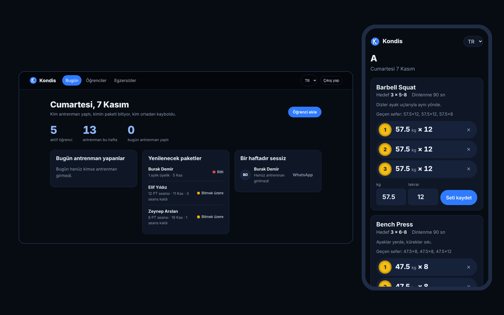
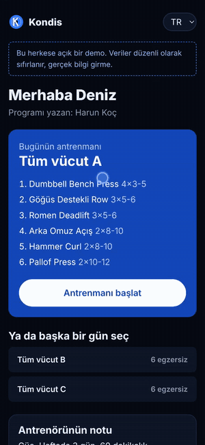
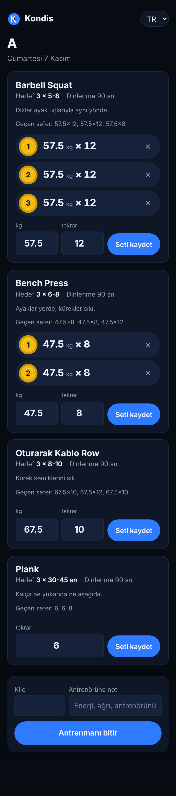
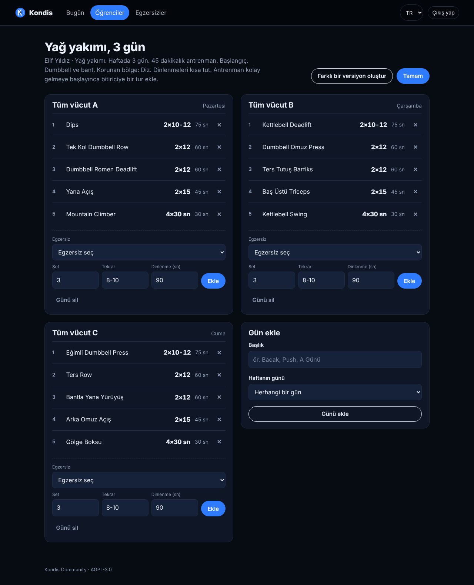
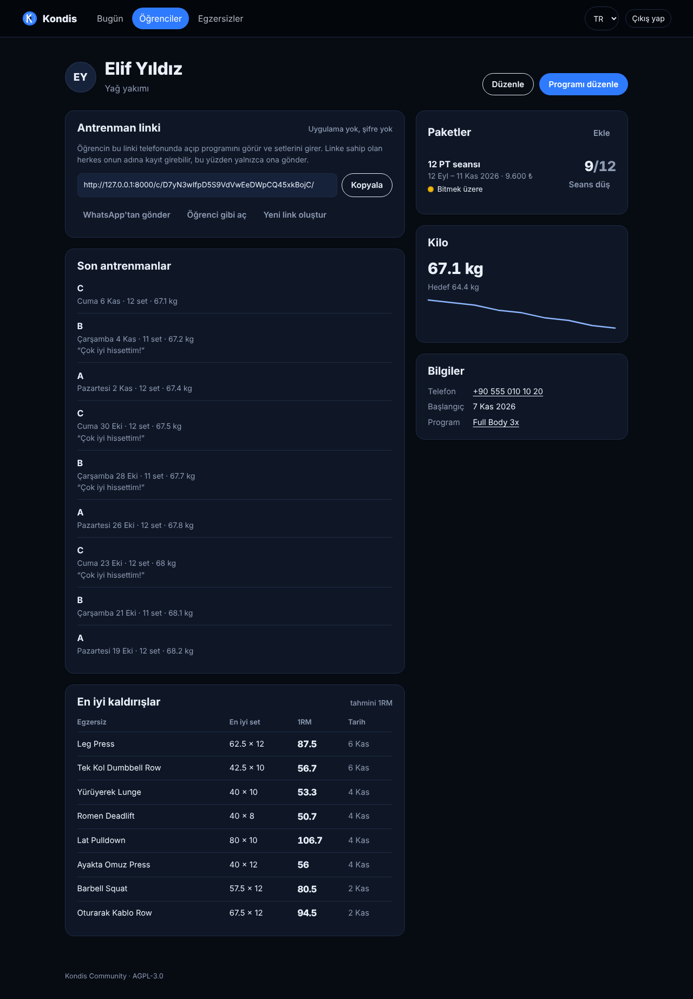

<p align="center">
  
</p>

<h1 align="center">Kondis</h1>

<p align="center">
  An open-source coaching panel for personal trainers and small gyms.<br>
  You write the program; your client opens a private link on their phone and logs sets. No app to install.
</p>

<p align="center">
  <a href="https://github.com/harunnkcnn/kondis/actions/workflows/ci.yml"></a>
  
   
  
</p>

<p align="center"><a href="README.md">Türkçe</a> · <b>English</b></p>

---



## Demo

**Watch:** [docs/kondis-demo.mp4](docs/kondis-demo.mp4) (100 s). A coach adds a client and generates a program for them, the client logs sets on a phone, the coach sees it on the dashboard.

**Try it:** the button below starts your own demo on Render's free plan with sample data. The login page offers "Try as a coach" and "Try as a client".

[](https://render.com/deploy?repo=https://github.com/harunnkcnn/kondis)

The free plan's temporary disk means every restart brings back clean sample data. It sleeps when idle, so the first load can take up to a minute.

## Why

Most personal trainers still run their clients on WhatsApp photos, spreadsheets and memory: when does this package end, did she train this week, what did he squat last Monday? Self-hosted trackers like [openGym](https://github.com/DuarteSantos8/openGym) and [wger](https://github.com/wger-project/wger) are great for the lifter. Kondis is built for the person writing the program.

- **A program of their own for every client.** Built from goal, level, days per week, session length, equipment (gym, dumbbells, home) and the joints to protect (knee, shoulder, lower back). Two clients with the same profile still get different plans, and another version is one click away.
- **No app for the client.** Each client gets a private link you can rotate at any time. Send it on WhatsApp; they open it, train, log.
- **Packages and sessions.** "12 PT sessions", "3 months": what's ended, what's ending and what has no sessions left sits on the home screen.
- **Who went quiet?** Clients without a workout in a week, one tap away from a WhatsApp message.
- **Your data.** Runs on your server, a cheap VPS or the gym's PC. No subscription, no ads, no tracking.

## Features

**Coach**
- Today screen: trained today, packages to renew, quiet for a week
- Client page: goal, notes, body-weight trend, recent workouts, best lifts (estimated 1RM, Epley)
- **Program generator**: picks a split from the schedule (full body for 2 days, upper/lower for 4, push/pull/legs for 6...), fills each slot by movement pattern, sets sets, reps and rest from the goal, and adds a progression note. Rule-based; no external service or API key.
- Exercises that load a protected joint are never picked; the next safe slot takes their place
- Program builder with days pinned to weekdays or a simple rotation (A, B, C, A...)
- Starter templates are still there: Full Body 3x, Upper/Lower, Push/Pull/Legs
- A 96-exercise library tagged by movement pattern and joint load, named in Turkish and English, plus your own
- Packages with dates, session count (or unlimited) and price; count a session with one tap



**Client (phone)**
- Suggests today's workout (by weekday, or the day after the last one done)
- Target, rest time, coaching cue and **last time's sets** on every exercise
- Weight and reps prefilled from the last set; sets are added without a page reload
- The set number sits on a disc coloured like a bumper plate by load (100+ red, 60+ blue, 40+ yellow, 20+ green)
- Body weight and a note for the coach at the end; new personal bests on the summary

<br clear="right">

| Workout | Program | Client |
|---|---|---|
|  |  |  |

## Quick start

```bash
git clone https://github.com/harunnkcnn/kondis.git
cd kondis
cp .env.example .env          # set KONDIS_SECRET_KEY and your domain
docker compose up -d --build
docker compose exec web python manage.py createsuperuser
```

Without Docker (Python 3.11 or newer). On Windows PowerShell:

```powershell
python -m venv .venv
.venv\Scripts\Activate.ps1
pip install -r requirements-dev.txt
$env:KONDIS_DEBUG="1"
python manage.py migrate
python manage.py seed_demo
python manage.py runserver
```

On macOS / Linux use `source .venv/bin/activate` and `export KONDIS_DEBUG=1` instead.

Demo login: `demo` / `kondis-demo-2026`

Configuration is environment-only; see [`.env.example`](.env.example) and the table in the [Turkish README](README.md#yayına-alma). Use HTTPS in production. All data lives in `./data` (or PostgreSQL via `KONDIS_DATABASE_URL`).

## Stack

Django (5.2 LTS or 6.x), htmx, hand-written CSS, SQLite or PostgreSQL, Gunicorn + WhiteNoise in a single container. Training logic (1RM, records, dashboard, templates) lives in `coaching/services.py`, independent of HTTP, and is covered by tests that run in CI.

## Security

Client links carry a 192-bit random token and can be rotated. Portal pages are `noindex`, `no-store` and use a restricted referrer policy. Coaches only see their own clients, and a link can only write to its own workouts; tests enforce both. Please report vulnerabilities privately as described in [SECURITY.md](SECURITY.md).

## Editions

**Community** (this repository, AGPL-3.0): one coach, unlimited clients, everything above.

**Pro** (in development, licensed add-on): several coaches with an owner view, payments and balances, WhatsApp reminders, branded PDF programs, measurements and progress photos.

## License

[AGPL-3.0](LICENSE). Use it, change it, self-host it. If you offer a modified version to others as a network service, you must publish that version's source under the same license.
