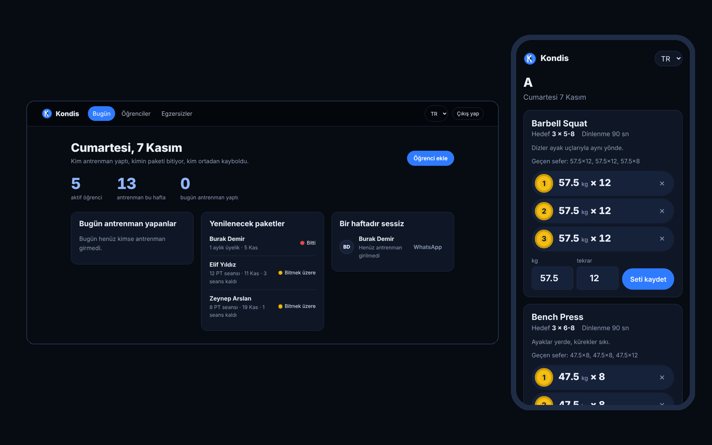
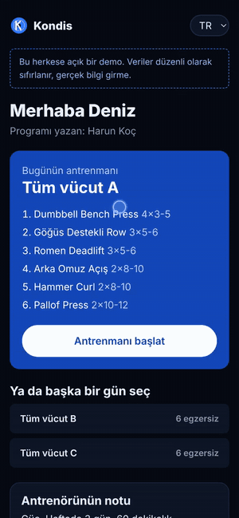
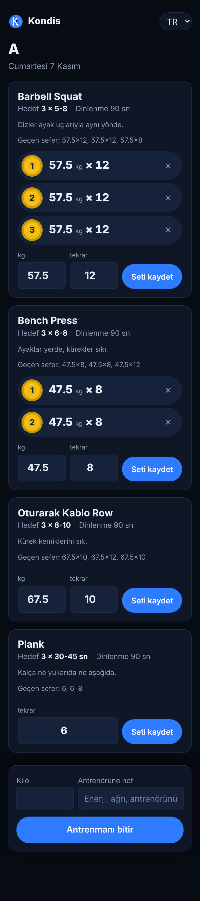
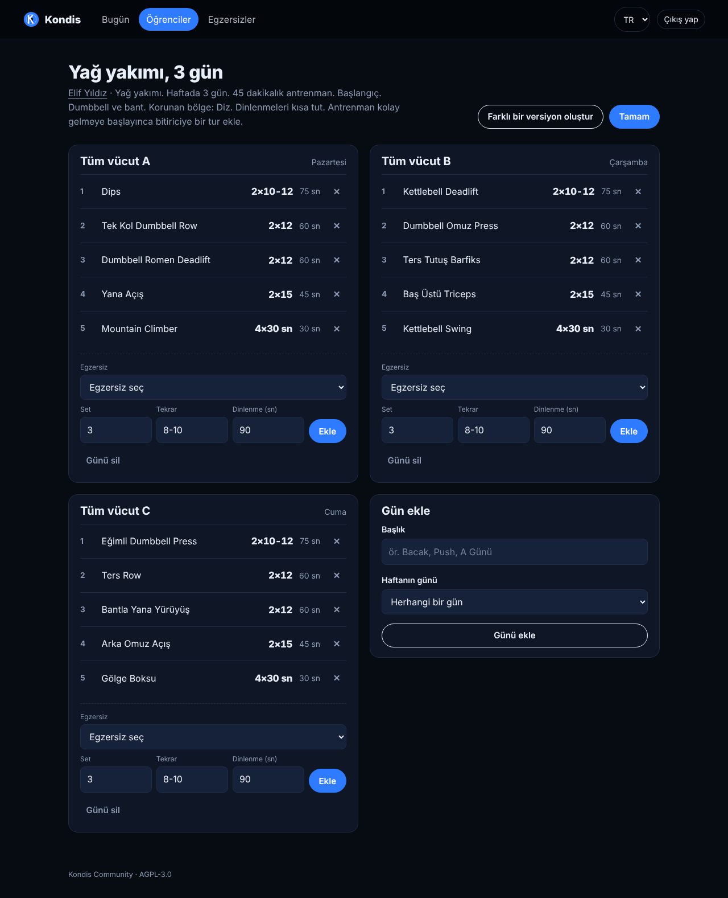
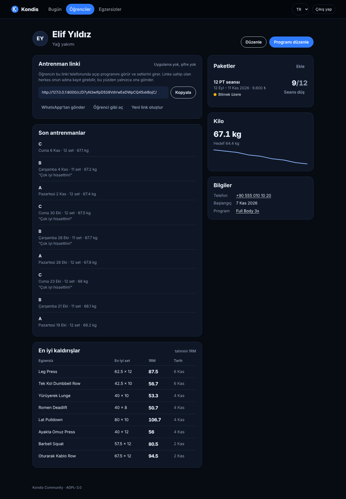

<p align="center">
  
</p>

<h1 align="center">Kondis</h1>

<p align="center">
  Kişisel antrenörler ve butik salonlar için açık kaynak antrenör paneli.<br>
  Programı sen yazarsın, öğrencin uygulama indirmeden linkten açıp setlerini girer.
</p>

<p align="center">
  <a href="https://github.com/harunnkcnn/kondis/actions/workflows/ci.yml"></a>
  
   
  
</p>

<p align="center"><a href="https://harunnkcnn.github.io/kondis/"><b>Tanıtım sayfası</b></a> · <b>Türkçe</b> · <a href="README.en.md">English</a></p>

---



## Demo

**Videoyu izle:** [docs/kondis-demo.mp4](docs/kondis-demo.mp4) (1,5 dk). Antrenör öğrenci ekleyip ona özel programı otomatik oluşturuyor, öğrenci telefondan setlerini giriyor, antrenör sonucu panelde görüyor.

**Kendin dene:** aşağıdaki butonla Render'ın ücretsiz planında örnek verili kendi demonu birkaç dakikada açabilirsin. Giriş ekranında "Antrenör olarak dene" ve "Öğrenci olarak dene" butonları çıkar.

[](https://render.com/deploy?repo=https://github.com/harunnkcnn/kondis)

Demo, ücretsiz planın geçici diski sayesinde her yeniden başlatmada temiz örnek veriyle açılır. Bir süre kullanılmayınca uykuya geçer; ilk açılış bir dakikayı bulabilir.

## Neden Kondis?

Türkiye'de PT'lerin çoğu öğrenci programını hâlâ WhatsApp'tan fotoğraf, Excel ve not defteriyle yürütüyor. Paket ne zaman bitiyor, öğrenci bu hafta geldi mi, geçen hafta squat'ta kaç kaldırdı... hepsi akılda tutulmaya çalışılıyor.

Kondis bunu tek bir panelde topluyor:

- **Her öğrenciye kendine özel program.** Hedef, seviye, haftalık gün sayısı, antrenman süresi, ekipman (salon, dumbbell, ev) ve korunacak eklemlere (diz, omuz, bel) göre program otomatik yazılır. Aynı profildeki iki öğrenciye bile farklı plan çıkar; beğenmezsen tek tıkla farklı versiyon.
- **Öğrenciye uygulama indirtmezsin.** Her öğrencinin kendine özel, istediğin an yenileyebileceğin bir linki var. WhatsApp'tan gönderirsin, telefonda açar, setini girer.
- **Paket ve seans takibi.** "12 PT seansı", "3 aylık üyelik" gibi paketler; biten, bitmek üzere olan ve seansı kalmayanlar ana ekranda.
- **Kim ortadan kayboldu?** Bir haftadır antrenman girmeyen öğrenciler tek tıkla WhatsApp'la listede.
- **Veri senin.** Kendi sunucunda, kendi bilgisayarında ya da ucuz bir VPS'te çalışır. Abonelik yok, reklam yok, izleme yok.

## Özellikler

**Antrenör tarafı**
- Bugün ekranı: bugün antrenman yapanlar, yenilenecek paketler, bir haftadır sessiz olanlar
- Öğrenci kartı: hedef, notlar (sakatlık vb.), kilo grafiği, son antrenmanlar, en iyi kaldırışlar (tahmini 1RM, Epley)
- **Otomatik program oluşturucu**: gün sayısına göre split seçer (2 gün tüm vücut, 4 gün üst/alt, 6 gün itiş/çekiş/bacak...), her slotu hareket kalıbına göre doldurur (squat, hinge, itiş, çekiş, izolasyon, core), set/tekrar/dinlenmeyi hedefe göre ayarlar ve ilerleme notu ekler. Kural tabanlı; dış servis ya da API anahtarı gerekmez.
- Korunan eklemi yükleyen egzersizler hiç seçilmez, boşalan slotu sıradaki güvenli hareket doldurur
- Program yazma: günlere bölünmüş program, haftanın gününe sabitleme ya da sıralı rotasyon (A, B, C, A...)
- Hazır şablonlar da duruyor: Full Body 3x, Upper/Lower, Push/Pull/Legs
- Hareket kalıbı ve eklem yüküyle etiketli, Türkçe ve İngilizce isimli 96 egzersizlik kütüphane + kendi egzersizlerin
- Paketler: tarih aralığı, seans sayısı (ya da sınırsız), ücret; "Seans düş" ile tek tıkla seans kullanımı



**Öğrenci tarafı (telefon)**
- Bugünün antrenmanını kendisi önerir (haftanın gününe ya da son yapılan güne göre)
- Her egzersizde hedef, dinlenme süresi, antrenörün ipucu ve **geçen seferki setler**
- Ağırlık ve tekrar alanları son değerlerle dolu gelir; setler sayfa yenilenmeden eklenir
- Set numarası, yüke göre renklenen bir plaka diski olarak görünür (100+ kırmızı, 60+ mavi, 40+ sarı, 20+ yeşil)
- Antrenman sonunda kilo ve antrenöre not; yeni rekorlar özet ekranında

<br clear="right">

| Antrenman | Program | Öğrenci kartı |
|---|---|---|
|  |  |  |

## Hızlı başlangıç

### Docker ile (önerilen)

```bash
git clone https://github.com/harunnkcnn/kondis.git
cd kondis
cp .env.example .env          # KONDIS_SECRET_KEY ve alan adını düzenle
docker compose up -d --build
docker compose exec web python manage.py createsuperuser
```

`http://localhost:8000` adresini aç ve oluşturduğun kullanıcıyla giriş yap.

### Docker'sız (geliştirme)

Python 3.11 ya da daha yenisi gerekir.

**Windows (PowerShell):**

```powershell
python -m venv .venv
.venv\Scripts\Activate.ps1
pip install -r requirements-dev.txt
$env:KONDIS_DEBUG="1"
python manage.py migrate
python manage.py seed_demo          # isteğe bağlı: örnek antrenör ve 5 öğrenci
python manage.py runserver
```

PowerShell betik çalıştırmayı engellerse önce `Set-ExecutionPolicy -Scope CurrentUser RemoteSigned` komutunu çalıştır.

**macOS / Linux:**

```bash
python3 -m venv .venv && source .venv/bin/activate
pip install -r requirements-dev.txt
export KONDIS_DEBUG=1
python manage.py migrate
python manage.py seed_demo
python manage.py runserver
```

Yeni bir terminal açtığında `KONDIS_DEBUG` ayarını tekrar yapman gerekir. PostgreSQL kullanacaksan `requirements-postgres.txt` dosyasını kur.

Demo girişi: `demo` / `kondis-demo-2026`

## Yayına alma

| Değişken | Ne işe yarar | Varsayılan |
|---|---|---|
| `KONDIS_SECRET_KEY` | Oturum imzalama anahtarı. Uzun ve rastgele olsun. | *(zorunlu)* |
| `KONDIS_ALLOWED_HOSTS` | Virgülle ayrılmış alan adları | `localhost,127.0.0.1` |
| `KONDIS_CSRF_TRUSTED_ORIGINS` | `https://` ile tam adres | *(boş)* |
| `KONDIS_BASE_URL` | Öğrenci linklerinde kullanılan adres | istek adresi |
| `KONDIS_DATABASE_URL` | `sqlite:///...` ya da `postgres://...` | `data/kondis.sqlite3` |
| `KONDIS_LANGUAGE` | Varsayılan dil (`tr` / `en`) | `tr` |
| `KONDIS_TIME_ZONE` | Saat dilimi | `Europe/Istanbul` |
| `KONDIS_SECURE_COOKIES` | HTTPS'te `1` | `1` |
| `KONDIS_HSTS_SECONDS` | HSTS süresi (HTTPS'ten eminsen) | `0` |

Öğrenci linkleri ve oturumlar için **HTTPS kullan**. Caddy, Nginx ya da Cloudflare Tunnel önüne konabilir. Tüm veri tek bir klasörde durur (`./data`); yedeklemek için o klasörü kopyalamak yeter. PostgreSQL için `KONDIS_DATABASE_URL` yeterli.

## Mimari

```
coaching/
  models.py      Öğrenci, Paket, Egzersiz, Program > Gün > Hareket, Antrenman > Set
  generator.py   Kural tabanlı program oluşturucu (split, slot, doz, öğrenciye özel tohum)
  library.py     Hareket kalıbı ve eklem yüküyle etiketli egzersiz kütüphanesi
  services.py    HTTP'den bağımsız iş mantığı: 1RM, rekorlar, ana ekran, şablonlar
  views.py       Antrenör paneli (her sorgu giriş yapan antrenöre göre filtrelenir)
  portal.py      Öğrenci ekranı (link anahtarıyla erişim)
templates/       Django şablonları + htmx
locale/tr/       Türkçe çeviriler
```

- **Django (5.2 LTS ya da 6.x) + htmx**: ayrı bir frontend build adımı yok, JavaScript bağımlılığı tek dosya.
- **SQLite varsayılan**, PostgreSQL destekli. Tek antrenör ya da küçük bir salon için SQLite fazlasıyla yeterli.
- Arayüz tamamen el yazımı CSS; koyu tema, telefon öncelikli, klavyeyle gezilebilir.

## Güvenlik

- Öğrenci linki 192 bit rastgele bir anahtar içerir; antrenör istediği an yeni link üretip eskisini geçersiz kılabilir.
- Öğrenci sayfaları `noindex`, `no-store` ve sınırlı `Referrer-Policy` ile sunulur.
- Her antrenör yalnızca kendi öğrencilerini görür; öğrenci yalnızca kendi antrenmanına set ekleyebilir. Bu kurallar testlerle korunur.
- Tüm formlarda CSRF koruması açık, yayında güvenli çerezler varsayılan.

Bir açık bulursan lütfen herkese açık issue yerine [SECURITY.md](SECURITY.md)'deki adrese yaz.

## Kondis Cloud (barındırılan sürüm)

`KONDIS_HOSTED=1` ile Kondis bulut hizmeti olarak çalışır: antrenörler `/signup/` sayfasından kendi kaydolur, **7 gün ücretsiz** kullanır, sonra abonelik gerekir. Deneme bitince veriler silinmez; antrenör abonelik sayfasına yönlenir, öğrenci linkleri "program durduruldu" mesajı gösterir.

| Değişken | Ne işe yarar |
|---|---|
| `KONDIS_HOSTED` | `1` = kayıt, deneme ve ödeme duvarı açık |
| `KONDIS_TRIAL_DAYS` | Deneme süresi (varsayılan `7`) |
| `KONDIS_PRICE_MONTHLY`, `KONDIS_PRICE_YEARLY` | Abonelik sayfasında gösterilen fiyat (₺) |
| `KONDIS_PAY_MONTHLY_URL`, `KONDIS_PAY_YEARLY_URL` | Ödeme sağlayıcının ödeme linki (iyzico, PayTR, Shopier...) |
| `KONDIS_SUPPORT_WHATSAPP` | Destek için WhatsApp numarası (`905xxxxxxxxx`) |

Ödeme gelince yönetim panelinde (`/admin/` → Subscriptions) antrenörü seçip **"Ödeme alındı: 1 ay ekle"** ya da **"1 yıl ekle"** demek yeterli. Kalıcı veri için bulut sürümünü PostgreSQL ya da kalıcı diskli bir sunucuda çalıştır; Render'ın ücretsiz planı sadece demo içindir.

Kendi sunucusuna kuranlar için bu mod kapalıdır; açık sürümde süre ya da öğrenci sınırı yoktur.

## Sürümler

**Community** (bu repo, AGPL-3.0): tek antrenör, sınırsız öğrenci, yukarıdaki tüm özellikler.

**Pro** (geliştiriliyor, lisanslı ayrı paket): birden fazla antrenör ve salon sahibi görünümü, ödeme ve borç takibi, WhatsApp hatırlatmaları, programı logolu PDF olarak paylaşma, ölçü ve fotoğraf takibi. Kurulum aynı kalacak; Pro paketi lisans anahtarıyla eklenecek. Haber almak için repoyu takip edebilirsin.

## Katkı

Hata bildirimleri ve pull request'ler açık. Başlamadan önce:

```bash
KONDIS_DEBUG=1 python manage.py test
```

Yeni bir metin eklediysen `locale/tr/LC_MESSAGES/django.po` dosyasına Türkçesini ekle (`python manage.py makemessages -l tr`, GNU gettext gerekir).

## Lisans

[AGPL-3.0](LICENSE). Kendi sunucunda kullanabilir, değiştirebilir ve paylaşabilirsin. Değiştirilmiş bir sürümü başkalarına ağ üzerinden hizmet olarak sunarsan, o sürümün kaynak kodunu da aynı lisansla açman gerekir.
